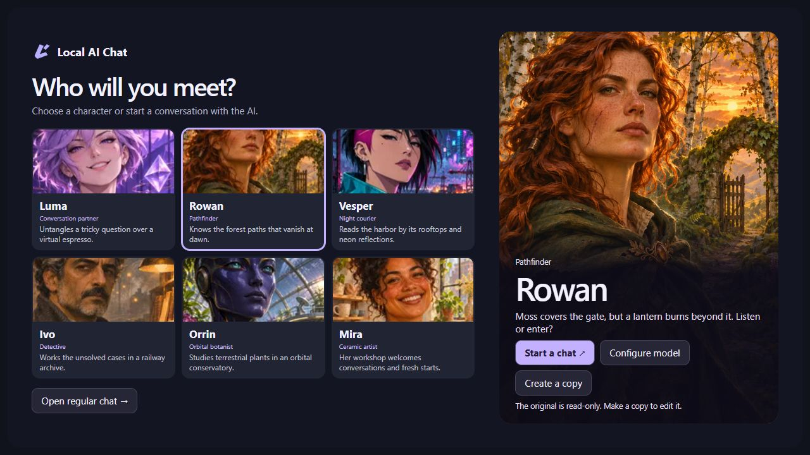
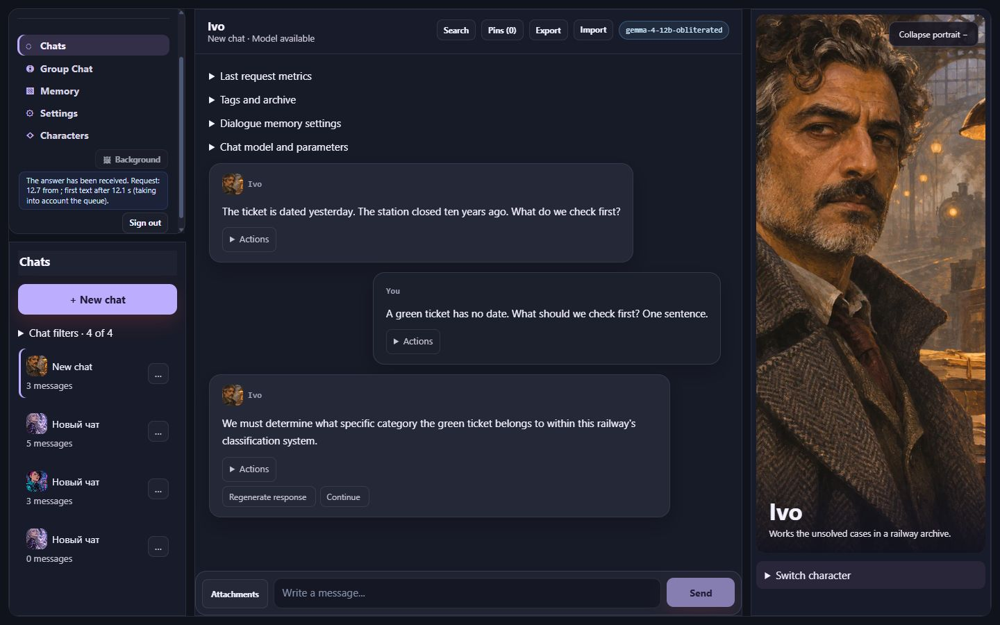
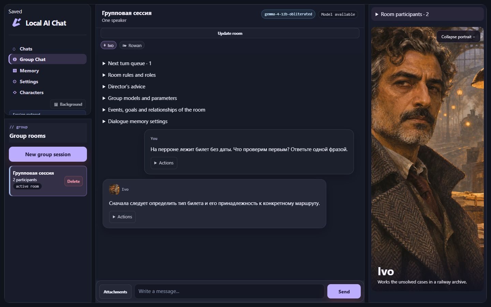

# Local AI Chat Studio Next

A local character chat for Windows. Choose a character, write your own, or put several characters in one room. Local AI Chat keeps the conversation and its history. A separate language model supplies the replies through LM Studio or another compatible server.

**Version 0.1.0** · [Download the Windows source package](https://github.com/LoLieB/local-ai-chat/archive/refs/heads/main.zip) · [Русский](README_RU.md) · [English PDF guide](docs/Local-AI-Chat-Guide-EN.pdf) · [Руководство в PDF](docs/Local-AI-Chat-Guide-RU.pdf)

## What you can do

- **Talk one-on-one.** Stream a reply, stop it, continue it, or retry. Search the conversation, pin messages and revisit branches.
- **Build a character.** Start with a name and instructions. Choose from 14 library portraits or add your own picture. The six gallery originals stay available when you edit a private copy.
- **Run a group conversation.** Choose participants and a turn-taking mode, including round robin. The portrait follows the current speaker.
- **Manage context.** Inspect the memory used in a conversation, edit saved facts and attach text. Image input requires a model with vision support.
- **Switch languages.** English and Russian cover the interface. Your conversations and character instructions stay in the language you wrote them in.

## First conversation on Windows

1. Install a compatible **Node.js LTS with npm** and **LM Studio**. Version 0.1.0 was tested on Windows x64. The Node.js range is `^20.19.0 || >=22.12.0`. Installation needs internet access for the dependencies and any model you choose to download. RAM, VRAM and storage needs depend on that model. [Node.js downloads](https://nodejs.org/en/download) · [LM Studio](https://lmstudio.ai/)
2. Extract **local-ai-chat-main.zip** into a writable folder. Inside the extracted **local-ai-chat-main** folder, open **1_INSTALL.bat**, wait for the build, then choose your own administrator password when prompted. [Illustrated installation guide](docs/Local-AI-Chat-Guide-EN.pdf)
3. In LM Studio, load your model and start its local server in **Developer**. When both programs are on the same computer, the usual base URL is `http://127.0.0.1:1234/v1`.
4. Open **2_START.bat**. Leave the launcher window open. Sign in as `admin` in the browser at `http://127.0.0.1:8787`. In **Settings**, enter the model server URL, select its model ID, save and test the connection.
5. Open the Studio gallery, select a character, choose **Start a chat**, then send a message. On subsequent days, start the model server and open **2_START.bat**. Press Enter in the launcher window to stop the app. [Windows quick start](README-FIRST-EN.md) · [Terminal setup](project/README.md)

If the model finishes with an empty reply and reasoning is enabled in LM Studio, try lowering the **reasoning token limit**. This leaves more of the loaded context available for the visible answer.

## Characters and group chats

In **Characters**, create a card or open the Studio gallery and make an editable copy. Give the character a name and a system prompt describing how it should speak. Choose its portrait, save, then select it in **Chats**.

In **Group Chat**, create a room, add your characters and select how turns are assigned. Add a room rule if you want the participants to follow a shared premise. Send a message and watch the speaker change as replies arrive.

The package includes 21 original illustrations: the six gallery characters, 14 library portraits and the Muse for regular chats. [Portrait contact sheet](images/studio-contact.jpg) · [Art sources](art-sources/) · [Artwork credits](project/public/studio/ASSETS.md)

## Data, backups and limits

Local accounts, characters, messages, memory and model settings are stored under `project/server-data/`. Settings offers an account export and restore. For a full backup, stop the app and copy `project/server-data/` and `project/.env` to a protected location. Keep your backup separate from the application folder before updating.

Passwords are hashed. Conversation content and session tokens are stored unencrypted on disk. The server listens on loopback by default. Messages and relevant context go to the model endpoint you configure. Public internet hosting has not undergone a separate security audit. Linux, macOS and a clean Windows installation have not been verified. Node.js, LM Studio and model weights are supplied separately.

## Guides and license

| | English | Русский |
|---|---|---|
| Illustrated beginner’s guide | [PDF](docs/Local-AI-Chat-Guide-EN.pdf) · [Markdown](docs/Local-AI-Chat-Guide-EN.md) | [PDF](docs/Local-AI-Chat-Guide-RU.pdf) · [Markdown](docs/Local-AI-Chat-Guide-RU.md) |
| Quick start | [Windows](README-FIRST-EN.md) | [Windows](README-FIRST-RU.md) |
| Version 0.1.0 | [Release notes](project/RELEASE-NOTES.md) | [Примечания к выпуску](project/RELEASE-NOTES.ru.md) |

The application source is licensed under MIT. Model licenses apply separately. [MIT license](LICENSE) · [Third-party notices](project/THIRD-PARTY-NOTICES.md)
