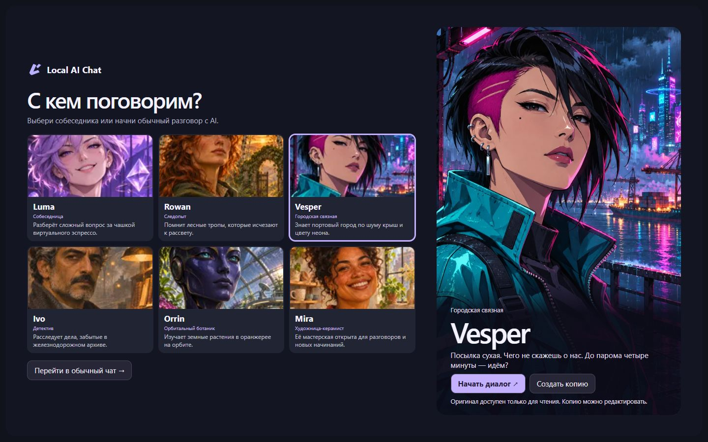
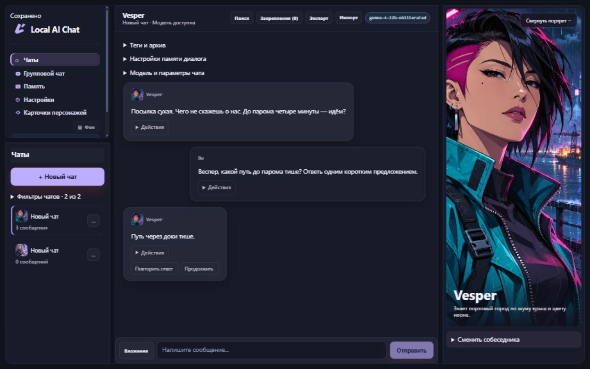
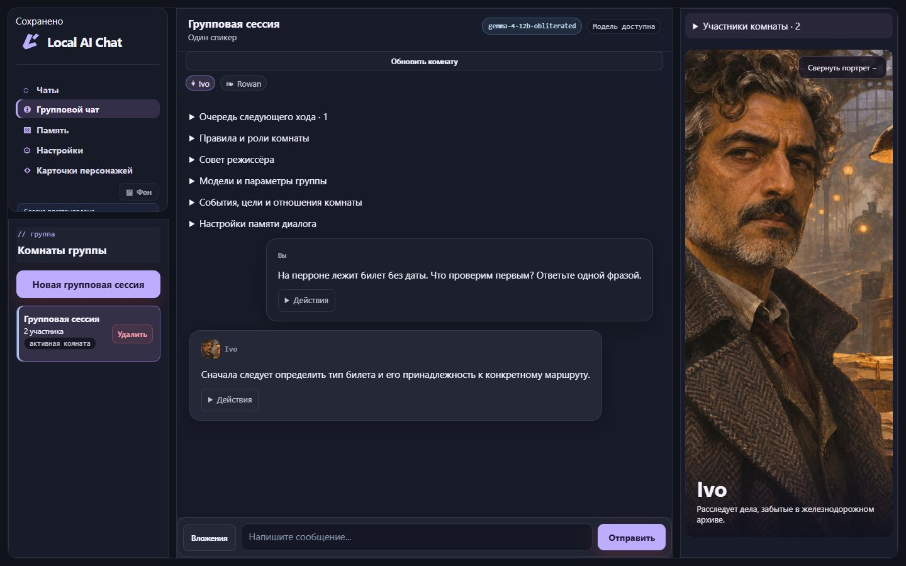

# Local AI Chat Studio Next

Локальное приложение для разговоров с AI-персонажами. Можно общаться один на один, создать своего собеседника или собрать нескольких персонажей в одной комнате. Приложение хранит историю и формирует контекст, а текст генерирует отдельная модель в LM Studio или на другом совместимом сервере.

**Версия 0.1.0** · [Скачать ZIP для Windows](https://github.com/LoLieB/local-ai-chat/releases/download/v0.1.0/local-ai-chat-0.1.0-public.zip) · [English](README.md) · [Руководство в PDF](docs/Local-AI-Chat-Guide-RU.pdf)

## Что умеет приложение

- **Личные чаты.** Ответ появляется по мере генерации. Его можно остановить, продолжить или запросить заново. В переписке есть поиск, закрепления и ветки.
- **Карточки персонажей.** Задайте имя и инструкцию, выберите один из 14 портретов или загрузите изображение. У любого из шести персонажей галереи можно создать личную редактируемую копию.
- **Групповые разговоры.** Пригласите в комнату несколько персонажей. Порядок ответов зависит от выбранного режима, а портрет показывает, кто сейчас говорит.
- **Память и вложения.** Посмотрите, какие факты попали в контекст, исправьте сохранённые сведения, приложите текст. Для работы с изображениями нужна модель с поддержкой зрения.
- **Русский и английский интерфейсы.** Язык можно поменять на экране входа или в настройках. Язык уже написанных сообщений и карточек сохраняется.

## Как начать на Windows

1. Установите совместимую LTS-версию **Node.js с npm** и **LM Studio**. Проверенная платформа — Windows x64. Приложению подходит Node.js в диапазоне `^20.19.0 || >=22.12.0`. Интернет нужен для загрузки зависимостей и выбранной модели. Требования к оперативной памяти, видеопамяти и диску зависят от модели. [Скачать Node.js](https://nodejs.org/en/download) · [Скачать LM Studio](https://lmstudio.ai/)
2. Распакуйте весь **local-ai-chat-0.1.0-public.zip** в папку с правом записи. Запустите **1_УСТАНОВИТЬ.bat**. Дождитесь сборки и задайте собственный пароль администратора.
3. Загрузите модель в LM Studio. В разделе **Developer** запустите локальный сервер. Если обе программы работают на одном компьютере, обычный адрес модели — `http://127.0.0.1:1234/v1`.
4. Запустите **2_ЗАПУСТИТЬ.bat** и оставьте его окно открытым. В браузере по адресу `http://127.0.0.1:8787` войдите как `admin`. В **Настройках** укажите адрес сервера модели, выберите её идентификатор, сохраните настройки и проверьте подключение.
5. Выберите персонажа в галерее, нажмите **Начать диалог** и напишите первое сообщение. В следующий раз достаточно включить сервер модели и снова открыть **2_ЗАПУСТИТЬ.bat**. Для завершения работы нажмите Enter в окне запуска. [Краткая инструкция](README-FIRST-RU.md) · [Установка через терминал](project/README.ru.md)

Если ответ пришёл пустым, а в LM Studio включены рассуждения, попробуйте уменьшить **лимит токенов на рассуждения**. Тогда в контексте останется больше места для текста ответа.

## Свой персонаж и групповая комната

В разделе **Карточки персонажей** создайте карточку или сделайте копию персонажа из галереи. Дайте ему имя и напишите инструкцию о том, как он должен вести разговор. Выберите портрет, сохраните карточку и выберите собеседника в **Чатах**.

В разделе **Групповой чат** создайте комнату, добавьте участников и выберите порядок ответов. Например, персонажи могут говорить по очереди. При необходимости задайте общие правила комнаты, затем отправьте сообщение.

В комплекте 21 оригинальная иллюстрация: шесть персонажей галереи, 14 библиотечных портретов и Муза обычного чата. [Все портреты](images/studio-contact.jpg) · [Исходные иллюстрации](art-sources/) · [Сведения об оформлении](project/public/studio/ASSETS.md)

## Хранение и резервные копии

Учётные записи, персонажи, история, память и параметры модели находятся в `project/server-data/`. В настройках можно экспортировать и восстановить данные аккаунта. Для полной копии остановите приложение и сохраните `project/server-data/` вместе с `project/.env` в защищённом месте. Перед обновлением храните копию отдельно от папки приложения.

Пароли хранятся в виде хешей. Переписки и токены сессий на диске не зашифрованы. По умолчанию сервер доступен с этого компьютера. Сообщения и выбранный контекст передаются на указанный вами сервер модели. Отдельного аудита безопасности для публичного интернет-хостинга не было. Linux, macOS и установка на чистую Windows не проверялись. Node.js, LM Studio и веса модели в комплект не входят.

[Русское руководство (PDF)](docs/Local-AI-Chat-Guide-RU.pdf) · [English guide (PDF)](docs/Local-AI-Chat-Guide-EN.pdf) · [Заметки о выпуске](project/RELEASE-NOTES.ru.md) · [MIT](LICENSE) · [Сторонние компоненты](project/THIRD-PARTY-NOTICES.md)
