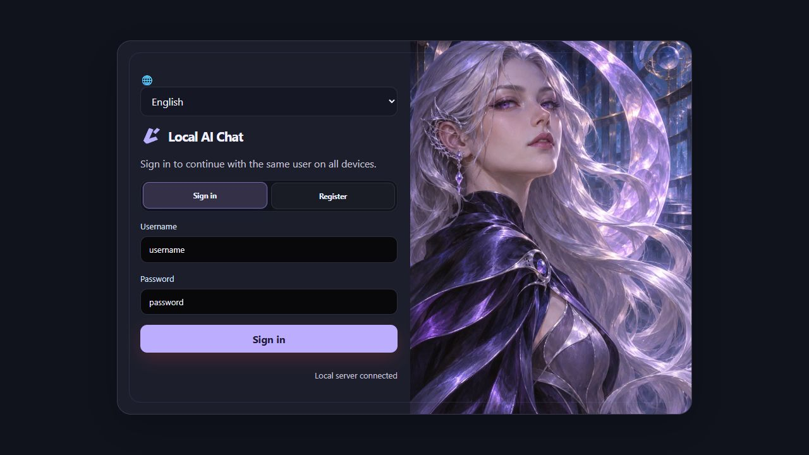
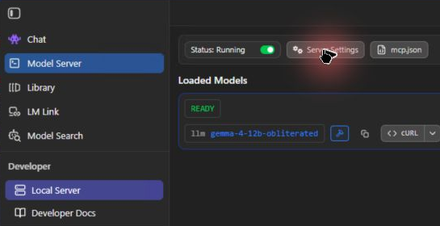
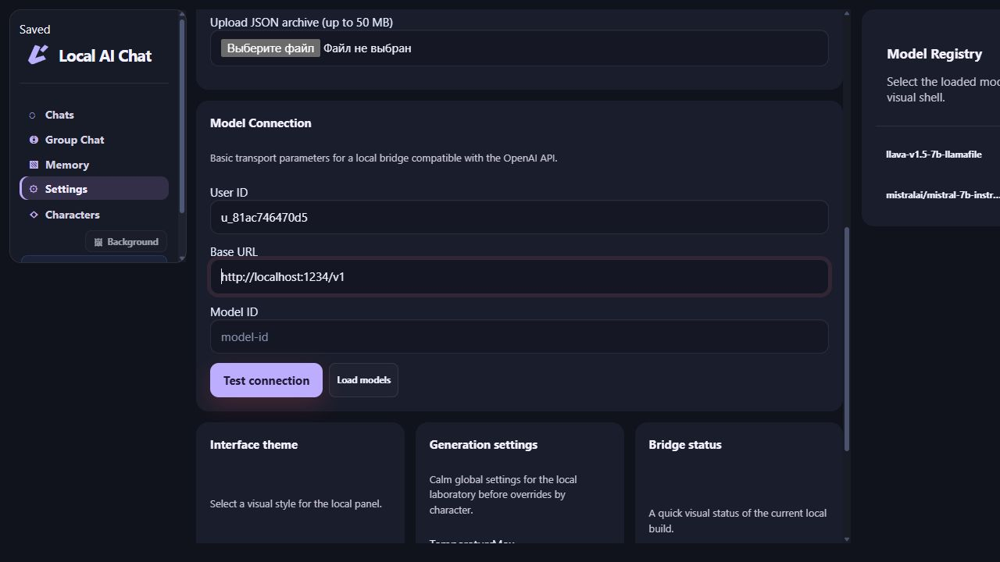
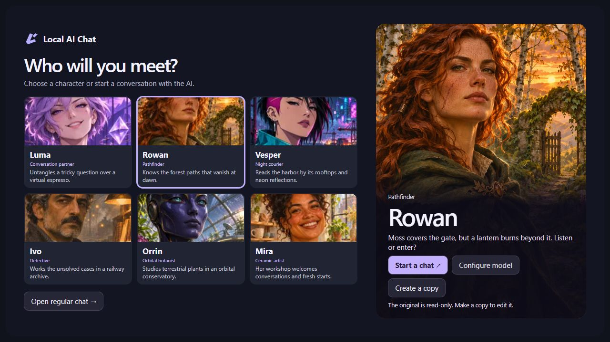
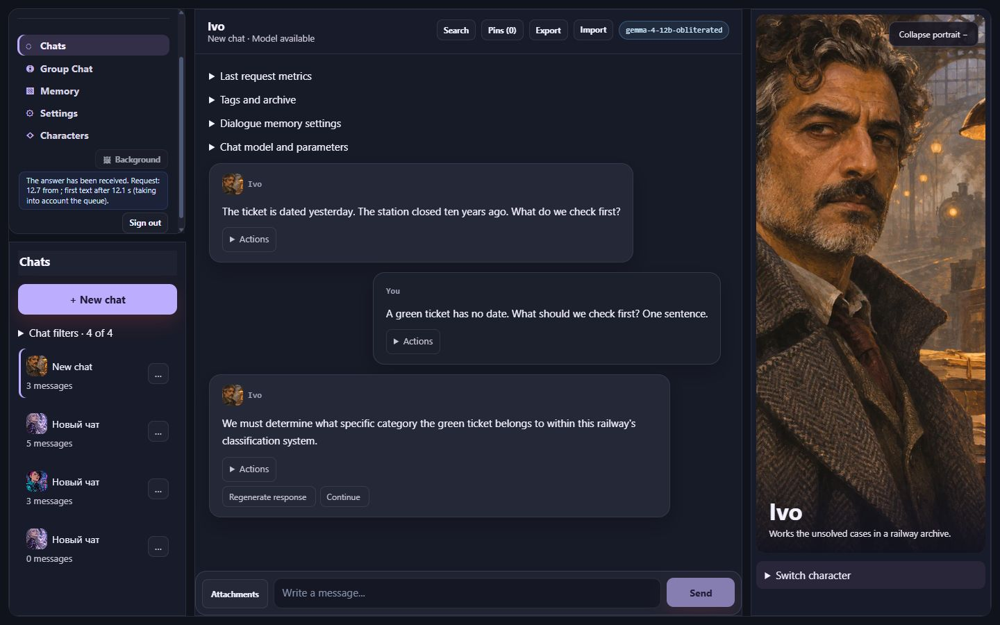
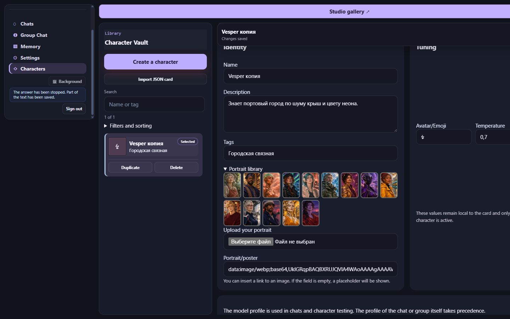
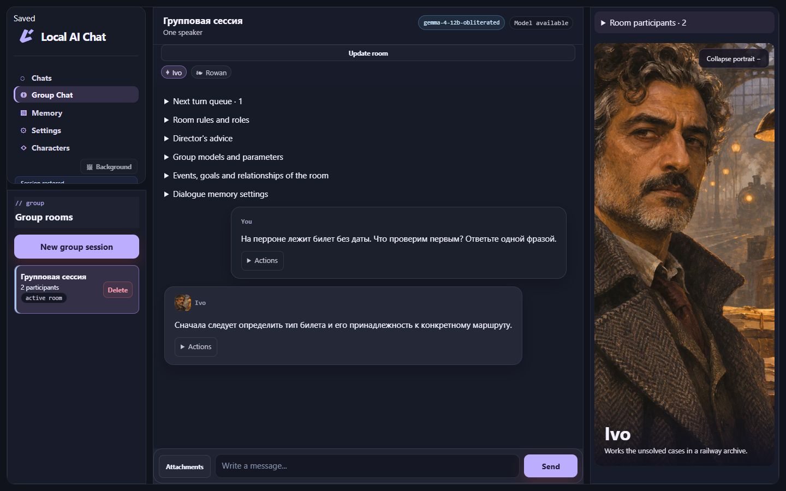
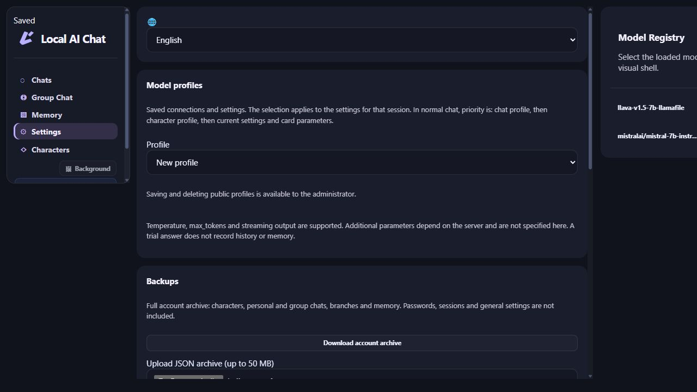

# Local AI Chat
## Beginner's guide

Version 0.1.0 · Windows · Source distribution

This guide walks you through installation, connecting a model in LM Studio, creating a character and protecting your work. The application and the model run separately. Do not share your personal data folder with other people.

## How to use this guide

For your first installation, follow chapters 2–6 in order. Chapters 7–8 are useful after your first conversation. If something goes wrong, find the symptom in the table in chapter 9. Enter the commands in PowerShell, press Enter after each command and wait for the next prompt. Never paste password lines into the terminal.

# 1. What the application does

Local AI Chat is an interface for conversations with characters, group discussions and memory. Its server stores accounts and data on your computer. A separate language model receives requests and generates replies. You will not get replies without a running compatible model server. Quality and speed depend on the model, hardware and settings; verify the model's answers.

# 2. What you need

The documented setup uses Windows x64, a browser, Node.js and npm, an internet connection to install dependencies, and LM Studio with a suitable loaded model. The archive does not include Node.js, the model or an installer. The project requires Node.js ^20.19.0 or >=22.12.0. Choose a current LTS version satisfying this requirement. Check the official requirements for LM Studio and your chosen model: memory needs depend on the model, its size, format and settings. Leave enough free disk space for the model and backups.

# 3. Install Node.js and LM Studio

1. Go to https://nodejs.org/en/download and download the Windows Installer for your architecture. Run the official installer and ensure that adding Node.js to PATH is selected. npm is installed with Node.js.
2. Close the old terminal and open a new PowerShell window. Run `node --version` and `npm.cmd --version`. If a command is not found, restart the terminal and check PATH. Use `npm.cmd` in PowerShell: execution policy may prevent `npm.ps1` from running.

Check: both commands should print version numbers, for example `v24...` and an npm version. If a command is not found, close and reopen the terminal. Do not change PowerShell's execution policy for npm: `npm.cmd` avoids the need to run npm.ps1.

3. Download LM Studio from https://lmstudio.ai/ and install it following the vendor's instructions. Find and download a suitable model, review its license and load it into memory. This download can be large; Local AI Chat does not include a model. On the model search screen, check the requirements, format and license of that particular model. After downloading it, open and load it in LM Studio and wait until it is ready. If it cannot load because of resource limits, choose a smaller compatible model; there is no single memory requirement for all models.

# 4. Install and start with a double click

1. Extract the entire archive into a writable folder.
2. Double-click `1_INSTALL.bat`. Internet is required for dependencies. Wait for installation and the build.
3. If Node.js is missing, https://nodejs.org/en/download opens. Download the Windows Installer for a supported LTS release, install with npm, then run the BAT again. Node.js 20.19+ or 22.12+ is required.
4. On first setup, choose an admin password of 12–256 characters and enter it twice. Input is completely hidden; press Enter after each entry. The password is stored as a hash, not in a BAT or `.env`.
5. After setup reports success, open `2_START.bat`. The browser opens after the server is ready. Sign in as `admin` with your password.
6. Keep the launcher window open. Press Enter in that window to stop normally. For daily use, start at step 5.

Re-running setup preserves accounts, passwords, `project/server-data` and an existing `.env`. Stop the application first. On failure, the window remains open and does not report success. The launcher does not terminate another process occupying the port; close that application normally.

If installing Node.js requires unavailable privileges, extract its entire official Windows x64 ZIP into `runtime/node` next to project, including node.exe, node_modules/npm and LICENSE. No runtime is bundled; this alternative has not been tested on clean Windows.

Install LM Studio from https://lmstudio.ai/ , load a model, open Developer and start the server. In Local AI Chat Settings, enter its URL and model ID. A typical same-computer URL is `http://127.0.0.1:1234/v1`. The app opens without LM Studio, but cannot generate replies.

Backups are available in Settings. For a complete backup, stop the app and copy `project/server-data` and `project/.env` to a protected location. No separate backup BAT is provided. Manual startup remains documented in project/README.md.

Advanced users: manual startup commands remain in project/README.md.

# 5. Start the model and API

In LM Studio, load a model, open the Developer tab and select Start server. Official guide: https://lmstudio.ai/docs/developer/core/server . In Local AI Chat settings, signed in as administrator, enter the base URL and model ID, then save and test the connection and load the model list. For a model server on the same computer, a typical address is http://127.0.0.1:1234/v1; check the actual port in LM Studio. Select the ID from the server's list rather than inventing one.

If LM Studio runs on another computer in a trusted network, use that computer's address and port with `/v1`; `127.0.0.1` means the computer running the Local AI Chat server. Enable network access in LM Studio and the firewall only if you understand the consequences. The official documentation at https://lmstudio.ai/docs/developer/openai-compat explains the compatible API. This version has no separate provider-key setting; a server requiring a token may not work. Do not expose the interface or model API to the internet.

A cropped screenshot of LM Studio: Developer → Local Server on the left, server status and Server Settings at the top, and the loaded model below. The network address and other parts of the window have been excluded. Do not change settings unnecessarily.

To test the connection, scroll the left panel in Settings to the connection section. For a separate computer, the LM Studio option may be called `Serve on Local Network`: read about it and allow access only on a trusted network. On Windows, if necessary, allow the required app or port for the Private network profile; do not disable the entire firewall. The setting's name and location depend on the LM Studio version. With network access enabled, devices on that network can reach the model server, so do not enable it on public networks.

Enter the server address ending in `/v1` in Base URL and select the loaded model's name in Model ID. Save and test the connection. Expected result: a success message and the number of available models. If these do not appear, first check LM Studio and the address. An example model name is only an example; enter your actual model ID.

Figure 2. Base URL points to the model server; Model ID selects the model. The loopback address shown is an example for a server on the same computer, not evidence of a successful connection.

# 6. Your first conversation in Studio

1. Your first sign-in opens the gallery. Select one of six characters to see their portrait, role and greeting. If no model is selected, Configure model opens the connection settings. An administrator can save shared connection settings.

2. Select Start a chat. The greeting comes from the character card. Write a question and use Send or Enter. Shift+Enter adds a new line. The reply appears in the history. Stop replaces Send while the model is generating.

3. Beneath the latest answer, retry generation or continue the existing reply. The Actions menu contains copy and other available commands. After stopping generation, wait for the save status. An empty model reply displays an error. Reload the page to see the conversation again.

4. Open regular chat starts a conversation without a character and shows the studio muse. Return through Characters → Studio gallery. The six originals are read-only. Create a copy gives you an independent private card with a new ID. The original conversation and memory stay with their original character.

5. Open your copy and change its name, instructions or greeting. Expand Portrait library and choose one of 14 portraits or upload a JPG, PNG or WebP. Select Save. The uploaded portrait travels with the card in account backups. To start with a blank card, choose Create character.

# 7. Interface sections

In Group chat, open Room participants and add characters. The right panel shows the speaking character, including changes during round-robin turns. After a reply it keeps the last speaker. On a phone, Sections opens navigation. The list and portrait have separate controls. Change Interface language in Settings. Your saved messages remain in their original language.

Chats contains the list of individual conversations, filters, search, pins, export, import and message actions. Image attachments require a model that supports images; attaching an image alone does not guarantee recognition.

Group Chat brings several created characters together in a room. Create a room, add participants and choose a response mode controlling which and how many characters reply per turn. Check the room rules and active speaker before sending; the model may fail to follow roles. A long conversation consumes the model's available context. Memory shows stored facts and context; review, edit or delete incorrect entries. Memory can belong to a user, character or specific chat, so check its scope before editing. Deleting a message does not necessarily delete a separately stored fact. Do not store secrets: memory and conversations are not encrypted on disk.

Settings contains the model connection, profiles, theme, generation settings and backups. Characters lets you create, edit, duplicate, import and export cards; version history is available. The interface offers Cinematic, Brutal and Studio themes. Items may vary with the current screen state.

Temperature affects response variation: lower values usually make choices more predictable, higher values more varied; the exact effect depends on the model. Max tokens limits the generated answer length, but some models can use the limit for internal reasoning. Streaming displays the response as it is generated; when disabled, you generally wait for the complete response. The chat profile takes precedence over the character profile, followed by current settings and card parameters. Save settings after changes and check the response.

Message actions include copying, pinning, editing, retrying, continuing and branching from a selected message. A branch lets you explore an alternative conversation while retaining the original history; check the active branch before continuing. Chat and character exports are separate files, not complete account backups. Add attachments using the attachments button; do not send sensitive files to an unknown model server. Attachment handling and supported formats depend on the application and selected model.

Figure 6. Settings includes the language selector, model profiles and backups.

# 8. Daily use and backups

Start LM Studio and load the model, then open 2_START.bat. The browser opens automatically. Wait for the saved status, then press Enter in the launcher window to stop.

In Settings → Backup & Restore, you can download an account archive and restore it into a new account. It contains user data but not passwords, sessions or shared settings. Shared settings can be downloaded separately. For a complete server backup, stop the application and copy the entire `server-data` folder and `.env` to a protected location. Test restoration on a separate copy; do not replace active data with empty data.

Before updating, make a complete backup, extract the new version separately, and transfer data and configuration only after checking that version's instructions. Run `npm.cmd ci` and `npm.cmd run build`. Keep the previous version and backup until you have verified the update.

# 9. Troubleshooting

| Symptom | Possible cause | What to do | Expected result |
| --- | --- | --- | --- |
| node not found | Node is missing from PATH | Install Node.js; open a new terminal | node --version shows a version |
| npm not found | npm or PATH unavailable | Check Node.js; run npm.cmd --version | npm version appears |
| PowerShell blocks npm.ps1 | Script execution policy | Use npm.cmd | Command runs |
| npm ci fails | Network, folder or lock file | Check internet and project/package-lock.json | Dependencies installed |
| Unsupported Node version | Old or incompatible version | Install a version from chapter 2 | Version meets package.json |
| Folder access denied | Insufficient write permission | Extract to a writable folder | Files are created without errors |
| Build fails | Dependencies or environment | Read the error; check npm ci and Node | npm.cmd run build succeeds |
| Page does not open | Application server is not running | Check npm.cmd start and address | Sign-in form appears |
| Port is in use | Another process uses the port | Set a free PORT in .env and restart | Server listens on that port |
| Cannot sign in as admin | Wrong password or existing data | Check original password; do not reset data | Sign in to the same account |
| No administrator | Initial password not set | Set INITIAL_ADMIN_PASSWORD and restart | Admin created if no account exists |
| Model missing from list | Model not loaded or wrong ID | Load model and refresh model list | ID appears in list |
| LM Studio unavailable | Server stopped or wrong address | Check Developer, port and /v1 | Connection test succeeds |
| Other computer unavailable | Network or binding restricts access | Check server address, network and firewall | Model connection succeeds |
| Empty model response | Token limit exhausted or model returned no text | Check and increase max tokens on card and chat | Model returns visible text |
| Very slow response | Model too large or device busy | Check model requirements and LM Studio load | Speed is acceptable for device |
| Image not recognized | Model lacks image support | Select a compatible vision model | Model describes image |
| Send unavailable | No character selected or generation in progress | Select a character or wait for completion | Send button becomes active |
| Data not saved | Write error or insufficient space | Check status, permissions and free space | Data remains after refresh |
| Backup rejected | Format, size or account name | Check JSON, size and new name | Backup restores to a new account |

# 10. Security and limitations

Passwords are stored as hashes, but history, memory, files and session tokens are not encrypted on disk. Anyone with access to the data folder or backup can read its contents. Protect your Windows account and storage, restrict folder access, and do not share `.env` or `server-data`. Network access increases the number of potential users; registration is open. Public internet hosting and protection against untrusted users have not been separately audited. Do not assume local use guarantees complete privacy: check where the model URL actually sends requests.

# 11. Printable quick reference

FIRST START: extract ZIP → 1_INSTALL.bat → install Node.js from the official site if prompted → enter your password twice → 2_START.bat → sign in in the browser.

DAILY: start LM Studio and load the model → start its server → start the application → check the model address and ID → select a character → chat → wait for the saved status → Enter in the launcher window to stop.

BACKUP: stop the application → copy `server-data` and `.env` to a protected location. The account archive in the interface is useful separately, but does not replace a complete server backup.

PROBLEM: no interface—check startup and port; no model—check API and ID; empty response—check token limits on the card and chat; data not saved—check disk access and the backup. Official sources: https://nodejs.org/en/download and https://lmstudio.ai/docs/developer/core/server .
