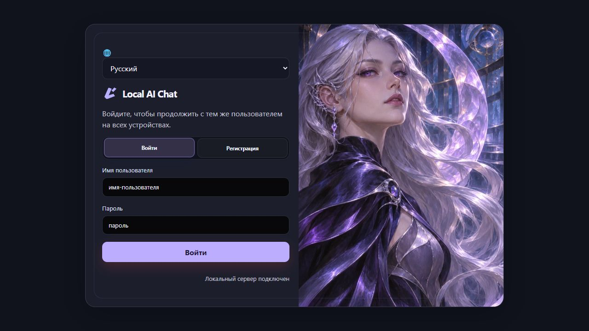
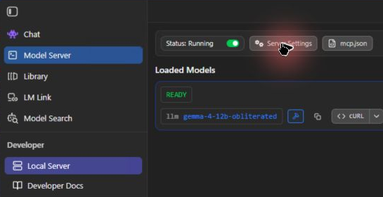
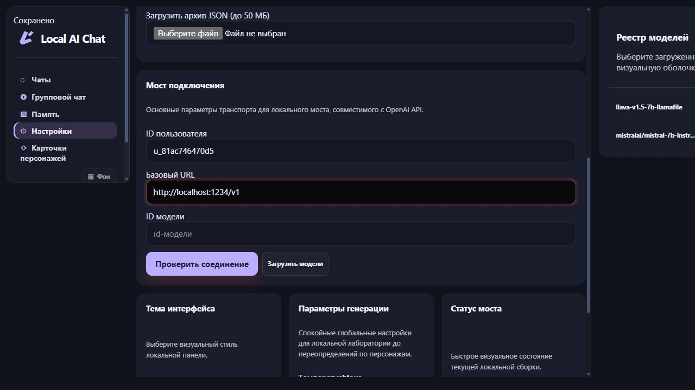
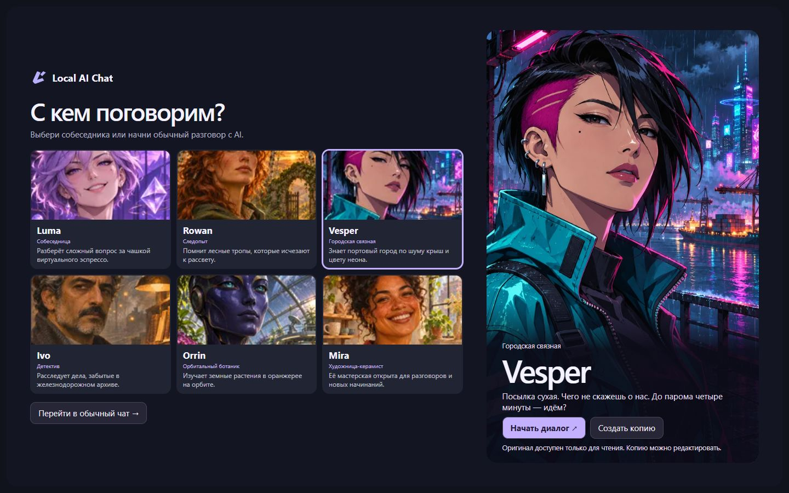
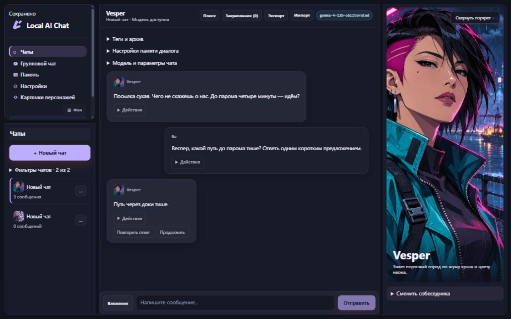
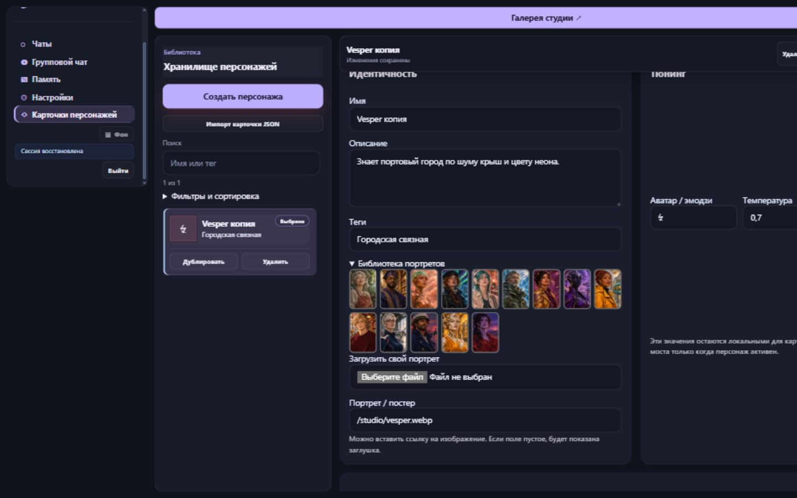
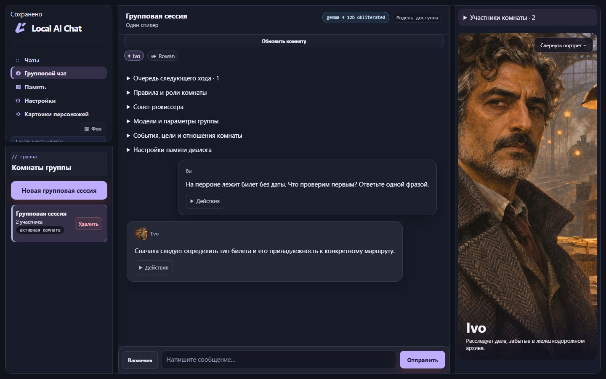
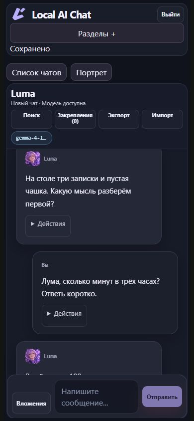
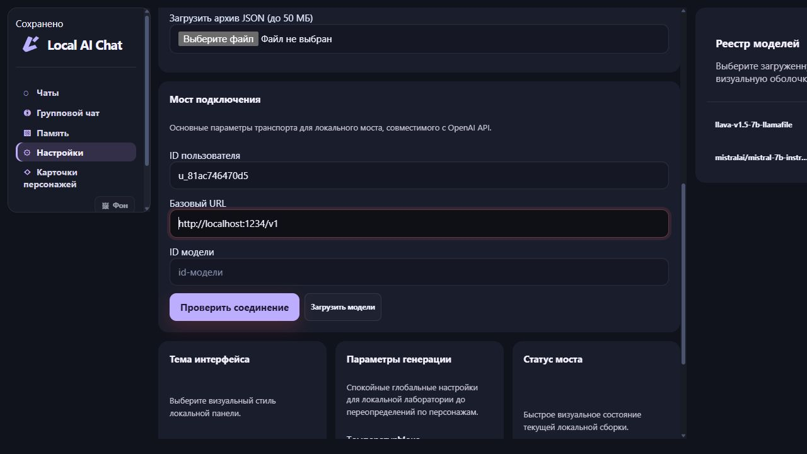

# Local AI Chat
## Руководство для начинающих

Версия 0.1.0 · Windows · Исходный комплект

Это руководство поможет установить приложение, подключить модель в LM Studio, создать персонажа и сохранить результаты. Приложение и модель работают отдельно. Передавать папку с личными данными другим людям не следует.

## Как пользоваться руководством

Идите по главам 2–6 по порядку при первой установке. Разделы 7–8 пригодятся после первого диалога. Если на каком-то шаге увидите ошибку, найдите симптом в таблице главы 9. Указанные команды вводятся в PowerShell; нажимайте Enter после каждой команды и дожидайтесь приглашения следующей строки. Строки с паролем в терминал не вставляйте.

# 1. Что делает приложение

Local AI Chat — интерфейс для диалогов с персонажами, групповых обсуждений и работы с памятью. Сервер приложения сохраняет учётные записи и данные на компьютере. Языковая модель отдельно принимает запросы и генерирует ответы. Без работающего совместимого сервера модели ответы не появятся. Качество и скорость зависят от модели, оборудования и настроек; ответы необходимо проверять.

# 2. Что понадобится

Проверенный сценарий — Windows x64, браузер, Node.js и npm, интернет для установки зависимостей, а также LM Studio с подходящей загруженной моделью. Поставленный архив не содержит Node.js, саму модель или установщик. Требование проекта: Node.js ^20.19.0 или >=22.12.0. Для первого знакомства выберите текущую LTS-версию Node.js, удовлетворяющую этому условию. Для LM Studio и выбранной модели проверьте требования на их официальных страницах: требуемый объём памяти зависит от модели, её размера, формата и настроек. Оставьте свободное место для модели и резервных копий.

# 3. Установка Node.js и LM Studio

1. Откройте https://nodejs.org/en/download и скачайте Windows Installer подходящей архитектуры. Запустите официальный установщик; убедитесь, что выбран пункт добавления Node.js в PATH. npm устанавливается вместе с Node.js.
2. Закройте старый терминал и откройте новый PowerShell. Выполните `node --version` и `npm.cmd --version`. Если команда не найдена, перезапустите терминал и проверьте PATH. В PowerShell используйте именно `npm.cmd`: запуск `npm.ps1` может быть ограничен политикой исполнения.
Проверка: команды версий выводят два номера, например `v24...` и версию npm. Если вместо этого терминал пишет, что команда не найдена, закройте его и откройте заново. Не меняйте политику PowerShell ради npm: команда `npm.cmd` обходит необходимость запускать npm.ps1.

3. Скачайте LM Studio с https://lmstudio.ai/ и установите по инструкциям производителя. В LM Studio найдите и скачайте подходящую модель, проверьте её лицензию и загрузите в память. Эта загрузка может быть большой; приложение Local AI Chat модель не содержит. На экране поиска модели проверьте требования, формат и лицензию конкретной модели. После скачивания откройте её в LM Studio и загрузите; дождитесь состояния готовности. Если загрузка не удалась из-за ресурсов, выберите меньшую совместимую модель — единой цифры памяти для всех моделей нет.

# 4. Установка и запуск двойным щелчком

1. Полностью распакуйте архив в доступную для записи папку.
2. Дважды щёлкните `1_УСТАНОВИТЬ.bat`. Нужен интернет для зависимостей. Дождитесь подготовки и сборки.
3. Если Node.js отсутствует, откроется https://nodejs.org/en/download . Выберите Windows Installer поддерживаемой LTS-версии, установите с npm и повторите BAT. Требуется Node.js 20.19+ либо 22.12+.
4. При первом запуске задайте пароль admin из 12–256 символов и повторите его. Ввод полностью скрыт; нажимайте Enter после каждого ввода. Пароль хранится как хеш, не в BAT и не в `.env`.
5. После сообщения об успехе откройте `2_ЗАПУСТИТЬ.bat`. Браузер откроется после готовности сервера. Войдите как `admin` со своим паролем.
6. Оставьте окно запуска открытым. Нажмите Enter в нём для штатной остановки. Для ежедневного запуска достаточно шага 5.

Повторная подготовка сохраняет аккаунты, пароль, `project/server-data` и существующий `.env`. Перед ней остановите приложение. При ошибке окно остаётся открытым; сообщения об успехе не будет. При занятом порте скрипт не завершает чужие процессы: закройте использующую порт программу обычным способом.

Если установка Node.js требует недоступных прав, можно распаковать весь официальный Windows x64 ZIP Node.js в `runtime/node` рядом с project. Внутри должны быть node.exe, node_modules/npm и LICENSE. Runtime не входит в комплект; этот вариант не проверен на чистой Windows.

Установите LM Studio с https://lmstudio.ai/ , загрузите модель, откройте Developer и запустите сервер. В Настройках Local AI Chat укажите URL и модель. Типичный адрес на одном компьютере: `http://127.0.0.1:1234/v1`. Без LM Studio приложение запускается, но AI не отвечает.

Резервная копия доступна в Настройках. Для полной копии остановите приложение и скопируйте `project/server-data` и `project/.env` в защищённое место. Отдельный BAT резервного копирования не добавлен. Ручной запуск для опытных пользователей сохранён в project/README.ru.md.

Для опытных пользователей: команды ручного запуска сохранены в project/README.ru.md.

# 5. Запуск модели и API

В LM Studio загрузите модель, откройте вкладку Developer и включите Start server. Официальное руководство: https://lmstudio.ai/docs/developer/core/server . В настройках Local AI Chat под администратором укажите базовый URL и ID модели, затем нажмите «Сохранить и проверить соединение» и «Загрузить модели». Для сервера модели на том же компьютере типичный адрес — http://127.0.0.1:1234/v1; фактический порт смотрите в LM Studio. Идентификатор берите из списка сервера, а не придумывайте.

Если LM Studio работает на другом компьютере в доверенной сети, используйте адрес именно этого компьютера и его порт с `/v1`; `127.0.0.1` означает компьютер с сервером Local AI Chat. Разрешите сетевой доступ в LM Studio и брандмауэре только если понимаете последствия. Официальная документация https://lmstudio.ai/docs/developer/openai-compat объясняет совместимый API. В этой версии отдельной настройки ключа провайдера нет; сервер с обязательным токеном может не подойти. Не открывайте интерфейс или API модели в интернет.

Фрагмент реального экрана LM Studio: слева Developer → Local Server, сверху состояние сервера и Server Settings, ниже загруженная модель. Сетевой адрес и остальные части окна исключены кадрированием. Не переключайте настройки без необходимости.

Проверка соединения: в «Настройки» прокрутите левую панель до «Мост подключения». Для отдельного ПК в настройках сервера LM Studio может называться `Serve on Local Network`: ознакомьтесь с параметром и разрешите сетевой доступ только в доверенной сети. В Windows при необходимости разрешите соединение для нужного приложения или порта в профиле «Частная сеть»; не выключайте брандмауэр целиком. Названия и расположение переключателя зависят от версии LM Studio. Адрес модели доступен устройствам сети при соответствующей настройке, поэтому не включайте доступ в общественных сетях.

В поле «Базовый URL» введите адрес сервера с `/v1`, в поле «ID модели» выберите имя загруженной модели. Нажмите «Сохранить и проверить соединение». Ожидаемый результат — сообщение об успешном соединении и количество доступных моделей. Если оно не появилось, сначала проверьте LM Studio и адрес. Значение example-model на рисунке — только пример; укажите реальный идентификатор своей модели.

Базовый URL указывает на API модели. Адрес localhost подходит для модели на том же компьютере.

# 6. Первый разговор в Studio

1. При первом входе откроется галерея. Выберите одну из шести карточек. Справа появятся портрет, роль и приветствие. Кнопка «Настроить модель» открывает настройки подключения, если модель ещё не выбрана. Общие параметры сохраняет администратор.

2. Нажмите «Начать диалог». Первое приветствие берётся из карточки. Спросите, например, «Какой путь до парома тише?» и нажмите «Отправить» или Enter. Shift+Enter начинает новую строку. Ответ появляется в истории. Во время генерации кнопка «Остановить» занимает место отправки.

3. Под последним ответом можно повторить генерацию или продолжить ответ. В меню «Действия» находятся копирование и другие доступные операции. После остановки дождитесь сообщения о сохранении. Если модель не вернула текста, приложение покажет ошибку. Обновите страницу и убедитесь, что разговор сохранился.

4. «Перейти в обычный чат» открывает разговор без персонажа, с фирменной музой справа. Позже галерею можно снова открыть из раздела «Карточки персонажей». Исходные карточки доступны только для чтения. «Создать копию» добавляет отдельную личную карточку с новым идентификатором. Переписка и память оригинала остаются на прежнем месте.

5. В редакторе копии измените имя, инструкции или приветствие. Раскройте «Библиотека портретов», выберите один из 14 вариантов или загрузите JPG, PNG либо WebP. Нажмите «Сохранить». Загруженная картинка входит в резервную копию карточки. Для собственной карточки с нуля используйте «Создать персонажа».

# 7. Разделы интерфейса

В «Групповой чат» откройте «Участники комнаты» и добавьте персонажей. В режиме по кругу справа появляется портрет фактического говорящего. После ответа в панели остаётся последний собеседник. На телефоне кнопка «Разделы» открывает навигацию. Список чатов и портрет открываются отдельными кнопками. Чтобы сменить язык, откройте «Настройки» и выберите «Язык интерфейса». Сохранённые сообщения остаются на исходном языке.

«Чаты» содержит список одиночных диалогов, фильтры, поиск, закрепления, экспорт, импорт и действия сообщений. Вложения изображений требуют модели, поддерживающей изображения; одно прикрепление не гарантирует распознавание.

«Групповой чат» объединяет нескольких созданных персонажей в комнату. Создайте комнату, добавьте участников и выберите режим ответа: кто и сколько персонажей отвечают за ход. Проверьте правила комнаты и активного говорящего перед отправкой; модель может ошибаться в следовании ролям. Длинный разговор потребляет доступный контекст модели. «Память» показывает сохранённые факты и контекст; просматривайте, редактируйте и удаляйте ошибочные записи. Память может относиться к пользователю, персонажу или конкретному чату, поэтому проверяйте область перед изменением. Удаление сообщения само по себе не обязательно удаляет отдельный сохранённый факт. Не записывайте секреты: память и переписка на диске не шифруются.

«Настройки» содержит подключение к модели, профили, тему, параметры генерации и резервные копии. «Карточки персонажей» позволяет создавать, менять, дублировать, импортировать и экспортировать карточки; доступна история версий. Интерфейс предлагает темы Cinematic, Brutal и Studio. Пункты могут отличаться в зависимости от состояния экрана.

Температура влияет на разброс ответов: меньшее значение обычно делает выбор более предсказуемым, большее — разнообразнее; конкретное действие зависит от модели. «Макс. токенов» ограничивает длину генерируемого ответа, но часть моделей может тратить лимит на внутреннее рассуждение. Потоковая выдача показывает ответ по мере генерации; при отключении обычно нужно дождаться полного ответа. Профиль чата имеет приоритет над профилем персонажа, затем используются текущие настройки и параметры карточки. После изменения параметров сохраните настройки и проверьте ответ.

В сообщениях доступны копирование, закрепление, редактирование, повтор и продолжение, а также ветвление от выбранного сообщения. Ветка позволяет исследовать другую линию диалога, сохраняя исходную историю; проверяйте активную ветку перед продолжением. Экспорт чата и карточки — отдельные файлы, а не полная резервная копия аккаунта. Вложения добавляются через кнопку «Вложения»; не отправляйте чувствительные файлы на неизвестный сервер модели. Возможность и формат обработки вложения зависят от приложения и выбранной модели.

Рисунок 5. Раздел настроек: профили моделей и резервные копии; прокрутите левую панель для полей подключения.

# 8. Ежедневная работа и резервные копии

Сначала запустите LM Studio и модель, затем откройте 2_ЗАПУСТИТЬ.bat. Браузер откроется автоматически. Дождитесь статуса «Сохранено», затем нажмите Enter в окне запуска для остановки.

В «Настройки → Резервные копии» можно скачать архив аккаунта и восстановить его в новый аккаунт. Он содержит пользовательские данные, но не пароли, сессии и общие настройки. Отдельно можно скачать общие настройки. Для полной серверной копии остановите приложение и скопируйте всю папку `server-data` и `.env` в защищённое место. Проверьте возможность восстановления на отдельной копии; не заменяйте действующие данные пустыми.

Перед обновлением обязательно сделайте полную резервную копию, распакуйте новую версию отдельно, перенесите данные и конфигурацию только после проверки инструкций версии, выполните `npm.cmd ci` и `npm.cmd run build`. Храните предыдущую версию и резервную копию до проверки.

# 9. Если что-то пошло не так

| Симптом | Возможная причина | Что сделать | Ожидаемый результат |
| --- | --- | --- | --- |
| node не найден | Node отсутствует в PATH | Установите Node.js; откройте новый терминал | node --version показывает версию |
| npm не найден | npm или PATH недоступен | Проверьте Node.js; введите npm.cmd --version | Показывается версия npm |
| PowerShell блокирует npm.ps1 | Политика запуска скриптов | Используйте npm.cmd | Команда запускается |
| npm ci завершилась ошибкой | Сеть, папка или lock-файл | Проверьте интернет и project/package-lock.json | Зависимости установлены |
| Версия Node не подходит | Старая или неподходящая версия | Установите версию из главы 2 | Версия соответствует package.json |
| Нет доступа к папке | Недостаточно прав записи | Распакуйте в свою доступную папку | Файлы создаются без ошибки |
| Сборка остановилась | Зависимости или ошибка среды | Прочитайте ошибку, проверьте npm ci и Node | npm.cmd run build завершается успешно |
| Страница не открывается | Сервер приложения не работает | Проверьте npm.cmd start и адрес | Форма входа отображается |
| Порт занят | Порт уже использует процесс | Укажите свободный PORT в .env и перезапустите | Сервер слушает выбранный порт |
| Не удаётся войти admin | Неверный пароль или старые данные | Проверьте исходный пароль; не сбрасывайте данные | Успешный вход в тот же аккаунт |
| Нет администратора | Пароль при первом запуске не задан | Задайте INITIAL_ADMIN_PASSWORD и перезапустите | Admin создаётся при отсутствии учётки |
| Модели нет в списке | Модель не загружена или неверный ID | Загрузите модель и нажмите Загрузить модели | ID доступен в списке |
| LM Studio недоступна | Сервер выключен или неверный адрес | Проверьте Developer, порт и /v1 | Проверка соединения успешна |
| Другой ПК недоступен | Сеть или привязка ограничивает доступ | Проверьте IP сервера, сеть и брандмауэр | Проверка модели проходит |
| Ответ модели пуст | Лимит исчерпан или модель не вернула текст | Проверьте и увеличьте max tokens карточки и чата | Модель возвращает видимый текст |
| Ответ очень медленный | Модель не помещается или устройство загружено | Проверьте требования модели и загрузку LM Studio | Скорость приемлема для устройства |
| Картинка не распознаётся | Модель не поддерживает изображения | Выберите совместимую vision-модель | Модель описывает содержимое |
| Отправка недоступна | Персонаж не выбран или идёт ответ | Выберите персонажа или дождитесь завершения | Кнопка отправки активна |
| Данные не сохранились | Ошибка записи или нет места | Проверьте статус, права и свободное место | После обновления данные на месте |
| Резервная копия не принята | Формат, размер или имя учётки | Проверьте JSON, размер и новое имя | Копия восстановлена в новый аккаунт |

# 10. Безопасность и границы

Пароли хранятся как хеши, но история, память, файлы и токены сессий на диске не шифруются. Любой, кто имеет доступ к папке данных или резервной копии, может прочитать содержимое. Защитите Windows-учётную запись и носитель, ограничьте доступ к каталогу, не отправляйте `.env` или `server-data` посторонним. Доступ к сети расширяет круг возможных пользователей; регистрация открыта. Публичный интернет-хостинг и защита от недоверенных пользователей отдельно не аудировались. Не считайте локальность гарантией полной конфиденциальности: проверьте, куда действительно направлен URL модели.

# 11. Печатная шпаргалка

ПЕРВЫЙ ЗАПУСК: распакуйте ZIP → 1_УСТАНОВИТЬ.bat → при необходимости установите Node.js с официального сайта → введите свой пароль дважды → 2_ЗАПУСТИТЬ.bat → войдите в браузере.

КАЖДЫЙ ДЕНЬ: запустить LM Studio и модель → запустить сервер модели → запустить приложение → проверить адрес и ID модели → выбрать персонажа → общаться → дождаться «Сохранено» → Enter в окне запуска для остановки.

РЕЗЕРВНАЯ КОПИЯ: остановить приложение → скопировать `server-data` и `.env` в защищённое место. Архив аккаунта в интерфейсе полезен отдельно, но не заменяет полную копию сервера.

ПРОБЛЕМА: нет интерфейса — проверить запуск и порт; нет модели — проверить API и ID; пустой ответ — проверить лимит токенов карточки и чата; нет сохранения — проверить доступ к диску и резервную копию. Официальные источники: https://nodejs.org/en/download и https://lmstudio.ai/docs/developer/core/server .
