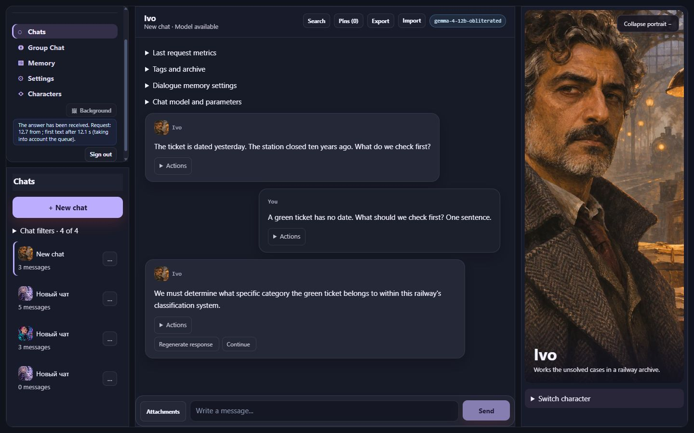

# Local AI Chat

## Studio Next

Studio opens a gallery of six characters at first sign-in. Choose one or open a regular chat with the muse. Characters → Studio gallery lets you revisit an original or create an editable private copy. The editor includes 14 library portraits and image uploads. Group chats show the speaking character on the right. Stop replaces Send during generation. Retry and Continue appear beneath the latest reply. Change the interface language in Settings.

Windows: open 1_INSTALL.bat in the package root, then 2_START.bat. [Click-by-click instructions](../README-FIRST-EN.md). Terminal commands below are for advanced users.

[English](README.md) | [Русский](README.ru.md)

Local AI Chat is a local web interface for individual and group conversations with characters, memory, attachments and backups. The language model runs separately, for example in LM Studio. Version 0.1.0 is distributed as source code, not as an installer, and includes no model or Node.js runtime.

The interface supports English and Russian. Use the language switch on the sign-in screen or in Settings. On first use, Russian is selected for a Russian browser preference; otherwise English is used. Your choice is saved in the browser. Switching the interface does not translate conversations, character prompts or model responses.

## Requirements

The documented setup uses Windows x64, a browser, internet access to install dependencies, and Node.js with npm. The project requires Node.js ^20.19.0 or >=22.12.0; other operating systems have not been verified. Install a compatible current LTS release from [nodejs.org](https://nodejs.org/en/download). Install [LM Studio](https://lmstudio.ai/) and a model separately; model hardware and storage requirements vary.

## Install and start

Extract the distribution, open PowerShell in its `project` folder and run:

```powershell
npm.cmd ci
Copy-Item .env.example .env
notepad .env
```

In `.env`, set `INITIAL_ADMIN_PASSWORD` to your own unique 12–256 character password. Do not enter the password on the command line or share the file. Leave `SERVER_TOKEN` empty for normal local use. Save and close the editor, then run:

```powershell
npm.cmd run build
npm.cmd start
```

Open http://127.0.0.1:8787 and sign in as `admin` with your chosen password. After the admin account is created, remove the value of `INITIAL_ADMIN_PASSWORD` from `.env` and restart the server. Stop it with Ctrl+C. Do not use `npm ci --omit=dev`: the server needs tsx from devDependencies. In PowerShell, `npm.cmd` avoids execution-policy issues with npm.ps1.

If the initial password is absent, the server can run without an administrator; ordinary registration is open and the name admin is reserved. An invalid password prevents admin creation. If admin already exists, the variable is ignored; it is not a password-reset mechanism and existing sessions are not reset.

## Connect a model and start chatting

Load a model in LM Studio and start its local OpenAI-compatible server. Signed in as admin, open Settings, enter the base URL (for example `http://127.0.0.1:1234/v1` when the model server runs on the same computer as the backend), and select the model ID from the server's list. Save and test the connection. Create a character with a name and system prompt under Characters, save it, then select it in Chats and send a message. Model profiles can be saved. If a reasoning model returns no visible text, check the maximum token limit in both the character card and chat.

The compatible API uses `/models` and `/chat/completions`, including streaming. There is no separate provider API-key setting, so providers requiring a key are not claimed as supported. Images require a vision-capable model; attaching an image does not prove it can be recognized.

## Guide and backups

The full beginner's guide covers installation, LM Studio, interface sections, troubleshooting and security: [PDF](../docs/Local-AI-Chat-Guide-EN.pdf) · [Markdown](../docs/Local-AI-Chat-Guide-EN.md).

Data is stored relative to the launch folder in `server-data/`, including accounts, sessions, history, characters and memory. Passwords are hashed, but conversation content and session tokens are not encrypted on disk. Stop the server before copying the entire `server-data` folder and `.env` to a protected location. The interface also offers an account backup and restore; it does not replace a complete server backup. Before upgrading, keep a backup, use a separate copy of the new version and verify the result before removing the old one.

## Access and security

`.env` is read at server startup. `PORT` controls the port (default 8787), and `HOST` controls the binding address (default 127.0.0.1); restart after changes. Network access broadens exposure and registration is open. This version is intended for local use; public internet hosting and protection from untrusted users have not been separately security-audited. Do not expose it directly to the internet or publish `.env` or `server-data`.

`SERVER_TOKEN` supports legacy launch methods and is not a substitute for authentication. If provided to the build, it is embedded in client JavaScript; do not use a provider secret there.

## Development and distribution

```powershell
npm.cmd run build
npm.cmd run test:server
node --test tests/portable/portable-core.test.mjs tests/portable/release-source.test.mjs
npm.cmd run dev
```

The build includes TypeScript checks. The dev interface is at http://127.0.0.1:5173. `npm run preview` serves the frontend build only and does not replace `npm start`. There is no dedicated lint script.

The source-release script accepts a destination that does not already exist and copies an allowlisted set of files with SHA256 checksums. Local data, runtime, installed dependencies, build output, logs and unverified images are excluded. Portable scripts require a separately prepared runtime and are not a ready-to-run portable application in this distribution.

Source code is available under the [MIT License](LICENSE). See [third-party notices](THIRD-PARTY-NOTICES.md) and [release notes](RELEASE-NOTES.md).


