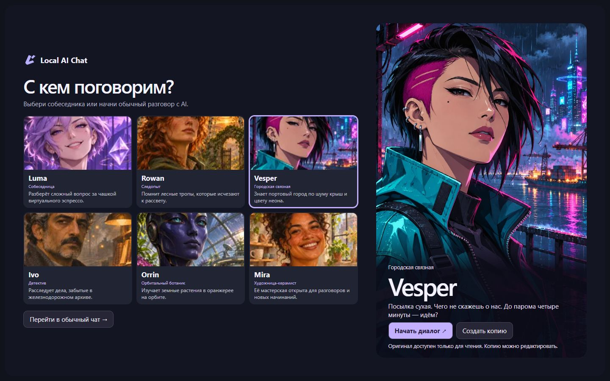

# Local AI Chat

## Studio Next

В Studio при первом входе можно выбрать одного из шести персонажей или открыть обычный чат с музой. В «Карточки персонажей → Галерея студии» доступны оригиналы и создание личной редактируемой копии. В редакторе есть 14 портретов и загрузка своей картинки. В группе справа виден отвечающий участник. «Остановить» заменяет кнопку отправки во время генерации. Повтор и продолжение находятся под последним ответом. Язык меняется в настройках.

Windows: в корне комплекта откройте 1_УСТАНОВИТЬ.bat, затем 2_ЗАПУСТИТЬ.bat. [Пошаговая инструкция](../README-FIRST-RU.md). Команды ниже оставлены для опытных пользователей.

[English](README.md) | [Русский](README.ru.md)

Локальный веб-чат с обычными и групповыми диалогами, персонажами, памятью,
вложениями и резервными копиями. Модель запускается отдельно, например в LM Studio.

## Язык интерфейса

Переключатель «Русский / English» доступен на экране входа и в настройках. При первом запуске выбирается русский, если предпочтительный язык браузера русский; иначе английский. Выбор сохраняется локально и имеет приоритет при следующих запусках. Переключение не переводит переписки, промпты персонажей или ответы модели.

## Интерфейс



Полное руководство: [PDF](../docs/Local-AI-Chat-Guide-RU.pdf) · [Markdown](../docs/Local-AI-Chat-Guide-RU.md).

## Установка из исходников

Проверяемая поставка первой версии — исходники, без Node.js, моделей, баз данных
и установщика. Проверено на Windows x64 с Node.js 24.18.0 и npm.
Требование package.json: Node.js ^20.19.0 или >=22.12.0; другие ОС не проверены.
Нужен интернет для установки зависимостей. Используйте Node.js 24 с npm.

Распакуйте архив исходников в отдельную папку и откройте в ней терминал:

```powershell
npm.cmd ci
Copy-Item .env.example .env
```

Если команда npm не найдена, установите Node.js с добавлением в PATH и откройте новый терминал. В PowerShell используйте npm.cmd, чтобы обойти ограничения запуска скриптов.

Откройте `.env` редактором и задайте `INITIAL_ADMIN_PASSWORD`: собственный
уникальный пароль длиной 12–256 символов. Не вводите пароль в командную строку.
Оставьте `SERVER_TOKEN` пустым для обычного локального запуска.

```powershell
npm.cmd run build
npm.cmd start
```

Откройте http://127.0.0.1:8787 и войдите как `admin` с выбранным паролем.
После первого входа удалите значение `INITIAL_ADMIN_PASSWORD` из `.env` и
перезапустите сервер. Для остановки нажмите Ctrl+C. Не используйте `npm ci --omit=dev`:
сервер запускается через tsx, который входит в зависимости разработки.

Без начального пароля сервер работает без администратора; обычная регистрация
доступна, имя admin зарезервировано. Неподходящий пароль останавливает создание
администратора. Если admin уже есть, переменная игнорируется: пароли и сессии
не сбрасываются. Это не механизм смены пароля существующей учётки.

## Подключение модели

В LM Studio загрузите модель и запустите локальный OpenAI-compatible сервер.
В настройках приложения под admin укажите базовый URL, например
`http://127.0.0.1:1234/v1`, и идентификатор загруженной модели из списка моделей.
Адрес относится к компьютеру с backend, а не к телефону, открывшему сайт.
Откройте «Карточки персонажей», создайте карточку с именем и системным промптом, сохраните её, затем в «Чатах» выберите персонажа и отправьте сообщение. Можно сохранять профили моделей.
Если модель завершила запрос без текста, увеличьте лимит токенов (в том числе
в карточке персонажа): модели с рассуждениями могут исчерпать его до финального ответа.

Поддерживается совместимый API `/models` и `/chat/completions`, включая потоковые
ответы. Облачные провайдеры с обязательным API-ключом не заявлены поддержанными:
отдельной настройки ключей провайдеров сейчас нет. Изображения требуют vision-модели;
само прикрепление картинки не доказывает, что модель умеет её распознавать.

## Настройки и доступ

`.env` загружается при запуске сервера. `PORT` задаёт порт (по умолчанию 8787),
`HOST` — адрес привязки (по умолчанию 127.0.0.1). После изменения нужен перезапуск.
Для доверенной локальной сети можно задать `HOST=0.0.0.0` и открыть адрес компьютера.
Регистрация открыта. Не выставляйте сервер напрямую в недоверенный интернет:
эта версия предназначена для локального использования, не для публичного сервиса.
Отдельный аудит безопасности для публичного интернет-хостинга не проводился.
Туннели не входят в проверенный сценарий первой поставки.

`SERVER_TOKEN` — дополнительная совместимость со старыми способами запуска,
не замена авторизации. При передаче этой переменной сборщику она встраивается
в клиентский JavaScript; не используйте здесь секрет провайдера.
Никогда не публикуйте `.env` или `server-data`.

## Данные и обновление

Данные сохраняются относительно папки запуска в `server-data/`: настройки,
учётки, сессии, история, персонажи и память. Учётки находятся в
`server-data/common-base/credentials.json`; пароли хранятся как хеши.
Содержимое переписок и токены сессий не зашифрованы на диске.
Запускайте команды из корня проекта и ограничьте доступ к этой папке.

Перед обновлением остановите сервер и сохраните отдельную копию всей папки
`server-data` и `.env`. Также доступен экспорт/восстановление пользовательской
резервной копии в интерфейсе; такой экспорт не заменяет полную резервную копию сервера.
Обновляйте исходники, сохраняя свои данные и конфигурацию, затем выполните
`npm ci`, `npm run build`, `npm start`. Не заменяйте рабочую базу пустой.
Существующие пароли сохраняются, включая ранее установленные слабые пароли.

## Проверки и разработка

```powershell
npm.cmd run build
npm.cmd run test:server
node --test tests/portable/portable-core.test.mjs tests/portable/release-source.test.mjs
npm.cmd run dev
```

`build` включает проверку TypeScript. Dev-интерфейс: http://127.0.0.1:5173.
`npm run preview` показывает только сборку фронтенда, не заменяет `npm start`.
Отдельного lint-скрипта нет.

## Состав поставки и ограничения

Для подготовки нового каталога исходников:

```powershell
node scripts/release-source.mjs ../local-ai-chat-source
```

Каталог назначения должен отсутствовать. Скрипт копирует только разрешённые
исходники и документацию, формирует SHA256SUMS.txt. Локальные данные, рабочие
заметки, runtime, node_modules, dist и изображения с неподтверждённым происхождением
не включаются. В интерфейсе предусмотрено отсутствие фоновых изображений.
Portable-скрипты в коде требуют отдельно подготовленного runtime и не являются
готовым переносимым приложением в этой поставке.

Исходный код распространяется по [MIT License](LICENSE), по выбору владельца.
Это не распространяется на исключённые сторонние изображения. Сведения о
зависимостях: [THIRD-PARTY-NOTICES.md](THIRD-PARTY-NOTICES.md).
Статус проверок и ограничения: [RELEASE-NOTES.md](RELEASE-NOTES.md).
